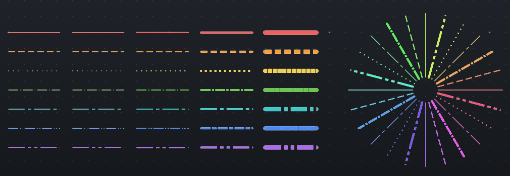

# femtoCAD

A small 2D CAD application in C++23 and Qt6. Today it imports and displays
DXF files with their layers, colors, linetypes and lineweights. Editing and
a native file format are planned.

- [Building](docs/building.md)
- [Contributing](CONTRIBUTING.md)
- [Architecture decisions](docs/adr/)
- [Example DXF files](examples/dxf/)
